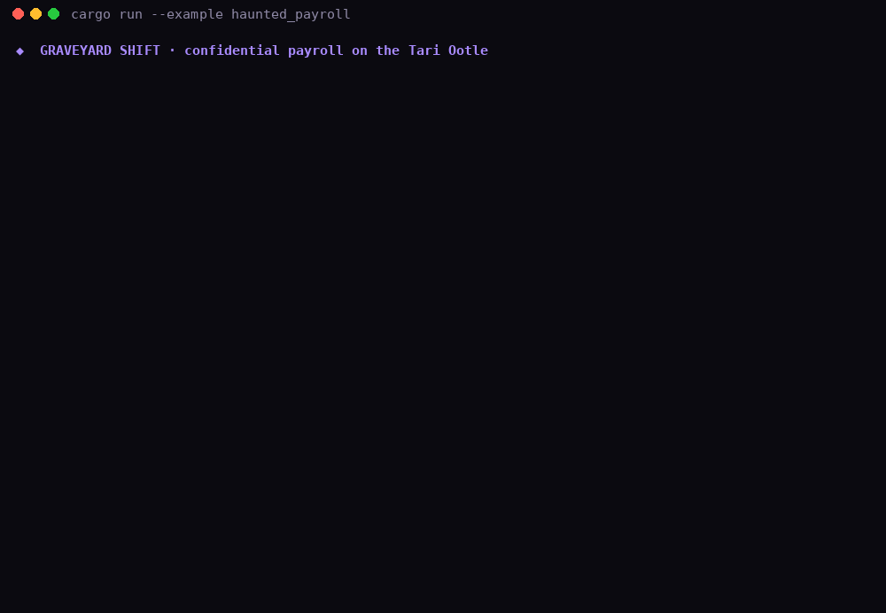
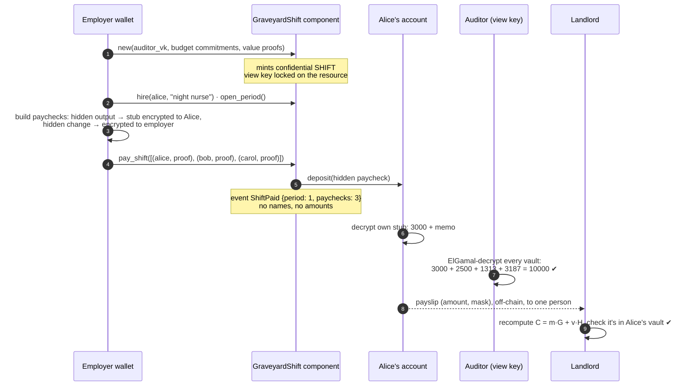
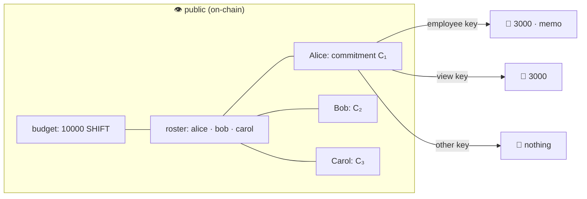

# 🦇 Graveyard Shift: payroll that stays in the dark

**Confidential payroll on the Tari Ootle.** No salary ever appears on-chain. Each employee reads
their own encrypted pay stub straight from the chain. A designated auditor reconciles the books
with a view key, and a coworker sees nothing at all.

[](https://github.com/XachP/graveyard-shift/actions/workflows/ci.yml)
· **26 engine tests** · MIT · *Tari Ootle "Spooky Secrets" contest, October 2026*

**▶ Try it in the browser (no wallet, 30 s):** https://xachp.github.io/graveyard-shift/
Pick a lantern (public, employee, auditor, coworker) and watch the same three paychecks change.

**🟢 Live on Esmeralda:** template [`93a17d16…`](https://explorer.tari.mw/template/93a17d16cce0cec637f618b0cda9a9a869ac706b4b98e77ee28aaa40b419e570) · payroll component [`component_7ffa9638…`](https://explorer.tari.mw/substate/component_7ffa963826ef41ea9d082c8142b7cb02c554b19bad91ee9de9f71ba62e6367fc) · [shift transaction](https://explorer.tari.mw/tx/ab2947b0fcb49adc66b30c68bc6f39832d7c218fdfcc292f5a16c1cc6ecbaeec). See [Live on Esmeralda](#-live-on-esmeralda-ootle-public-testnet).



---

## 🟢 Live on Esmeralda (Ootle public testnet)

Graveyard Shift is published on Esmeralda and has paid a real night shift. Judges can open every
object below in the [Veil explorer](https://explorer.tari.mw) or as raw JSON from the public indexer.

| What | Address / tx | Links |
|---|---|---|
| Template `GraveyardShift` | `93a17d16cce0cec637f618b0cda9a9a869ac706b4b98e77ee28aaa40b419e570` | [explorer](https://explorer.tari.mw/template/93a17d16cce0cec637f618b0cda9a9a869ac706b4b98e77ee28aaa40b419e570) · [indexer](https://ootle-indexer-a.tari.com/templates/93a17d16cce0cec637f618b0cda9a9a869ac706b4b98e77ee28aaa40b419e570) |
| Payroll component | `component_7ffa963826ef41ea9d082c8142b7cb02c554b19bad91ee9de9f71ba62e6367fc` | [explorer](https://explorer.tari.mw/substate/component_7ffa963826ef41ea9d082c8142b7cb02c554b19bad91ee9de9f71ba62e6367fc) · [indexer](https://ootle-indexer-a.tari.com/substates/component_7ffa963826ef41ea9d082c8142b7cb02c554b19bad91ee9de9f71ba62e6367fc) |
| Confidential `SHIFT` token (auditor view key locked on) | `resource_7f7e726d1a87f15052ca5ec94227f25eebaa773580bb2e0b8e881265229bcef1` | [explorer](https://explorer.tari.mw/substate/resource_7f7e726d1a87f15052ca5ec94227f25eebaa773580bb2e0b8e881265229bcef1) |
| Publish template tx | `cb4494d56fe2c04c6cbad62c23c1ac69f7e708d81a520996bd1befc6617c0acc` | [explorer](https://explorer.tari.mw/tx/cb4494d56fe2c04c6cbad62c23c1ac69f7e708d81a520996bd1befc6617c0acc) |
| `new(...)` tx: opening budget 10,000 SHIFT + 2 employee accounts | `ca55a282e81382774f8698f329aa58abe5b3b9034f6fb06ba654098f36434f9d` | [explorer](https://explorer.tari.mw/tx/ca55a282e81382774f8698f329aa58abe5b3b9034f6fb06ba654098f36434f9d) |
| **Night shift tx**: `hire` ×2 · `open_period` · `pay_shift` in one transaction | `ab2947b0fcb49adc66b30c68bc6f39832d7c218fdfcc292f5a16c1cc6ecbaeec` | [explorer](https://explorer.tari.mw/tx/ab2947b0fcb49adc66b30c68bc6f39832d7c218fdfcc292f5a16c1cc6ecbaeec) · [indexer](https://ootle-indexer-a.tari.com/transactions/ab2947b0fcb49adc66b30c68bc6f39832d7c218fdfcc292f5a16c1cc6ecbaeec) |
| Night nurse account | `component_a1073a7c6beaaf8031b80d66eb9c9d9a7b5e3a00d7efb497d09fe1032786aa9a` | [explorer](https://explorer.tari.mw/substate/component_a1073a7c6beaaf8031b80d66eb9c9d9a7b5e3a00d7efb497d09fe1032786aa9a) |
| Gravedigger account | `component_aafb1b07b970795213ddf3d8d0be8dc014764940cb0446f8f6bed25001269f36` | [explorer](https://explorer.tari.mw/substate/component_aafb1b07b970795213ddf3d8d0be8dc014764940cb0446f8f6bed25001269f36) |

In the shift transaction, look at the events: `Hired`, `Hired`, `PeriodOpened {period: 1}`,
`ShiftPaid {period: 1, paychecks: 2}`. There are no amounts anywhere. Each paycheck is a `coutput_…`
substate holding a commitment, an encrypted pay stub and an ElGamal viewable balance.

**Check it from public chain state.** `examples/live_esmeralda.rs` reads the vaults and outputs from
the public indexer and decrypts them with each party's key
([output](docs/demo/live_esmeralda_verify.json)):

| Output | Employee key opens | Auditor view key reads |
|---|---|---|
| night nurse paycheck | 3000 · "October night shift: 12 nights, ward 13" | 3000 |
| gravedigger paycheck | 2500 · "October night shift: 9 plots, lantern allowance" | 2500 |
| treasury change | (employer's key) | 4500 |
| **total** | | **10000 = public budget ✔** |

Fees for the whole deployment (publish + create + shift) came to about **1.5 tTARI**. The funds came
from CPU-mining Esmeralda L1 (SHA-3x) and burning tXTM to the Ootle account with the official
burn-and-claim bridge, because the public faucet was empty. The demo keys are test-only.

```bash
# reproduce against your own walletd (employer key lives in the wallet daemon)
cargo run --example live_esmeralda -- init <employer_account_public_key>
cargo run --example live_esmeralda -- new <template_hex> <employer_account> <max_epoch> <max_fee>   # → unsigned tx JSON for transactions.submit
cargo run --example live_esmeralda -- shift <component> <employer_account> <max_epoch> <max_fee>    # set GS_INPUTS=<treasury coutput ids>
cargo run --example live_esmeralda -- verify https://ootle-indexer-a.tari.com <resource> "label=vault_…" …
```

## Why this matters

Every business runs payroll, and no business can run it on a transparent chain. A block explorer
would show every salary, raise and severance to coworkers, competitors and scammers. That isn't a
niche worry. Pay confidentiality is a legal and HR requirement in most companies, and it's why
real payroll never touches public chains.

But payroll can't be a black box either. Accountants, tax authorities and boards need to check
the books. **The Ootle can do both at once**, with primitives a transparent chain doesn't have:

| | Transparent chain | Mixer / custodian | **Graveyard Shift on Ootle** |
|---|---|---|---|
| Salaries hidden from the public | ✘ | ✔ | ✔ Pedersen commitments + range proofs |
| Employee gets pay info without a side channel | n/a | trust the custodian | ✔ encrypted pay stub on their output |
| Auditor can reconcile | ✔ (so can everyone) | trust the custodian | ✔ resource view key (ElGamal) |
| Auditor can't spend | n/a | ✘ | ✔ view key ≠ spend key |
| Employer can't pay off-book | ✘ | ✘ | ✔ engine requires a proof the auditor can read |
| Prove one salary to one landlord | ✘ (everyone sees it) | ✘ | ✔ payslip opening checked against the chain |

## The four lanterns

| 🕯 Lantern | Holds | Sees |
|---|---|---|
| 👁 **The public** | nothing | the public budget, the roster, that a shift was paid and its head count, and opaque commitments. **No amounts anywhere**: state, events and receipts were all scanned in tests |
| 🔑 **The employee** | own key | **their own** amount, mask and private memo ("36h nights + 4h overtime"), decrypted from the chain. Can spend it confidentially |
| 📜 **The auditor** | resource view key | **every amount**, enough to prove `Σ paychecks + treasury = public budget`. **No memos. No spending power** |
| 🦇 **A coworker** | any other key | nothing |

## Ootle privacy features used

* **Confidential resources.** The `SHIFT` payroll token is `ResourceBuilder::confidential()`. Balances are Pedersen
  commitments with Bulletproof range proofs.
* **Resource view keys.** `.with_view_key(auditor)`: every output carries an ElGamal
  `ViewableBalanceProof` to the auditor, and **the engine refuses outputs without one**.
* **Encrypted output data.** Each paycheck's `EncryptedData` is DH-encrypted to the employee
  (`encrypt_value_and_mask`): amount, mask and memo, with memo length padded to size tiers.
  Treasury change is encrypted to the employer, so the employer's wallet can be rebuilt from chain state.
* **`ConfidentialWithdrawProof`.** Paychecks spend treasury commitments into one hidden output and hidden change.
  Revealed amounts are rejected.
* **Value proofs** on mint, so the total budget is public while every split stays private.
* **Atomic multi-payment transactions.** `pay_shift` pays the whole crew in one transaction with a
  single `ShiftPaid {period, paychecks}` event, so per-person payment timing doesn't leak within a run.

## Architecture





### Methods

| Method | Who | What |
|---|---|---|
| `new(auditor_vk, budget, value_proofs)` | anyone (becomes the employer) | creates the confidential `SHIFT` token with the auditor view key and mints the opening budget |
| `hire(account, role)` / `terminate(account)` | employer | public roster (role label only, max 64 bytes); rehire after termination is allowed |
| `open_period()` | employer | next pay period; each active employee can be paid once per period |
| `pay(account, proof)` | employer | one confidential paycheck → event `PaycheckIssued {employee, period}` |
| `pay_shift([(account, proof)…])` | employer | up to 64 paychecks, atomic, one `ShiftPaid {period, paychecks}` event |
| `top_up(budget, value_proofs)` | employer | mint more confidential budget (total becomes public, split doesn't) |
| `roster`, `period`, `is_paid_this_period`, `staff_count`, `paychecks_issued`, `public_budget`, `treasury_commitment_count`, `payroll_resource` | anyone | read-only, never amounts |

## Run it

```bash
rustup target add wasm32-unknown-unknown
cargo test                                   # 26 tests on the real Ootle engine
cargo run --example haunted_payroll 2>/dev/null   # the narrated night shift (the GIF above)
cargo build --release --target wasm32-unknown-unknown   # → graveyard_shift.wasm (~190 KB)
```

`cargo run --example haunted_payroll -- --json docs/demo/transcript.json` then
`python3 docs/build_demo.py` regenerates the browser demo from a fresh engine run. Every commitment,
ciphertext and decryption on the page comes from that run, and the page decrypts nothing itself.

### Tests (26, all against the real engine)

| Area | Tests |
|---|---|
| Hidden salaries + reconciliation | salaries hidden / auditor reconciles · books reconcile across a month (raise, exit, top-up) · top-up grows only the public budget |
| Encrypted pay stubs | employee reads own stub from chain · auditor sees amount but not memo · coworkers can't open each other's stubs · employer rebuilds treasury from chain alone · employee spends paycheck, landlord reads rent |
| Payslips | honest payslip verifies · inflated, borrowed and forged payslips are caught |
| One-transaction shifts | one tx, one amountless event · one bad paycheck pays nobody (atomic) · same person twice rejected · empty shift rejected |
| Leak checks | events carry no amount fields · whole receipt scanned for the salary in decimal, LE bytes and hex |
| Guard rails | revealed paychecks rejected · off-book (no view-key proof) rejected by the engine · double pay · terminated staff · pay before a period opens · hire twice / rehire · outsiders can't hire, pay, open periods, top up, terminate or run shifts · auditor can't spend · internal helpers not callable |

See **[THREAT_MODEL.md](THREAT_MODEL.md)**, which maps 17 attacks to the test that plays each one, plus what still leaks.

## Honest limits

* **The roster is public** (account + role + paid-this-period). An auditable headcount needs that.
  Paying into stealth UTXOs would hide recipients too, and that's next.
* **The total budget is public** (supply tracking). The split isn't.
* **The auditor key is fixed per payroll** and opens all amounts of this token.
* **Testnet only.** Live on Esmeralda with test keys (see above). Not on mainnet, and unaudited.

> Build note: `tari_template_test_tooling 0.47.0` doesn't compile against `tari_crypto 0.24.1`.
> `Cargo.lock` pins `0.24.0`. If you regenerate the lock, run `cargo update -p tari_crypto --precise 0.24.0`.

## Roadmap

1. ~~Deploy to Esmeralda and record explorer links for a full shift.~~ Done (see above).
2. Stealth paychecks, so the roster is private too (pay to one-time stealth outputs and prove
   headcount with a counter).
3. Sapient Web Extension page for employees: connect, read your stubs, export a payslip.
4. Auditor CLI that reconciles straight from the indexer.

## Disclosure

Built with an AI coding agent under the submitter's direction. All code is new for this contest (October 2026). MIT.
